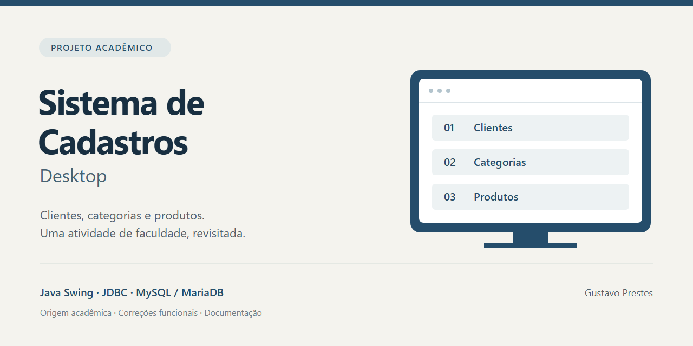
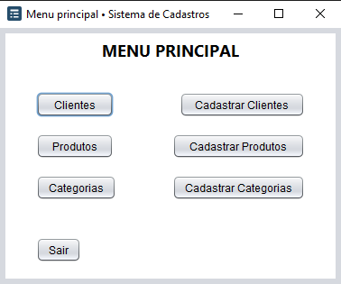
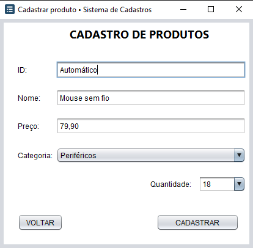
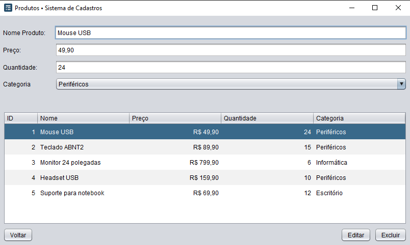
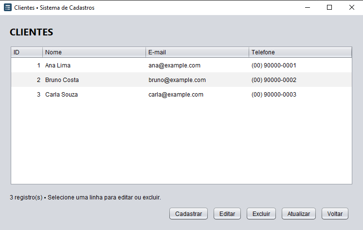

<p align="center">
  
</p>

# Sistema de Cadastros Desktop

Aplicação desktop para cadastrar, consultar, editar e excluir clientes, categorias e produtos, com dados armazenados em um banco relacional.

## Sobre o projeto

Este projeto começou como uma atividade da faculdade para praticar Java, interfaces gráficas com Swing, JDBC e operações CRUD em banco de dados. A versão original foi publicada com o nome `meucrud` e permanece no histórico do Git.

Posteriormente, o projeto recebeu uma revisão pontual: foram corrigidos problemas nas consultas e atualizações de produtos, conectadas as listagens de clientes e categorias ao banco e concluídas suas ações de edição e exclusão. Também foram feitos pequenos ajustes nos formulários, na configuração de execução e na documentação.

A revisão mantém a estrutura original de telas, entidades e DAOs, assim como o uso de Swing e os arquivos de formulário do NetBeans. O objetivo continua sendo um projeto acadêmico simples, que pode ser executado e explorado localmente.

## Telas

| Menu principal | Cadastro de produto |
| --- | --- |
| [](docs/screenshots/menu.png) | [](docs/screenshots/cadastro-produto.png) |

| Produtos | Clientes |
| --- | --- |
| [](docs/screenshots/produtos.png) | [](docs/screenshots/clientes.png) |

[Ver também a listagem de categorias](docs/screenshots/categorias.png).

Capturas reais da aplicação executada no Windows, conectada a uma instância local de MariaDB com dados fictícios. O formulário de produto foi preenchido para ilustrar a entrada de dados. As cores e fontes podem variar conforme o sistema operacional.

## Funcionalidades

- Cadastro, consulta, edição e exclusão de clientes, categorias e produtos.
- Associação opcional de um produto a uma categoria.
- Preços com duas casas decimais e apresentação em reais.
- Entrada de preço com vírgula ou ponto, como `49,90` ou `49.90`.
- Quantidade inteira a partir de zero; no cadastro, também é possível digitar valores fora da lista.
- Validação de nomes, e-mail opcional, preço e quantidade.
- Confirmação antes de excluir um registro.
- Ordenação das listagens clicando nos cabeçalhos das colunas.
- Persistência dos dados após fechar e reabrir a aplicação.

Ao excluir uma categoria, seus produtos permanecem cadastrados e passam a aparecer como **Sem categoria**. Clientes e produtos vinculados às tabelas de vendas não podem ser excluídos, conforme as chaves estrangeiras do banco.

## Tecnologias

- Java 21;
- Swing e formulários do NetBeans;
- Maven, com Maven Wrapper incluído;
- JDBC com MariaDB Connector/J;
- MySQL/MariaDB;
- JUnit 5 para verificar as validações e os DAOs.

## Como executar

### Requisitos

- JDK 21, com `JAVA_HOME` configurado;
- MySQL ou MariaDB em execução (pode ser o serviço do XAMPP);
- Internet na primeira execução, para baixar Maven e dependências;
- Ambiente gráfico para abrir as janelas Swing.

O projeto é uma aplicação Java desktop. Ele não precisa ficar na pasta `htdocs`, nem utiliza Apache para executar. O phpMyAdmin pode ser usado para importar o banco.

### 1. Obter o código

```bash
git clone https://github.com/gustavokkj/sistema-cadastros-java.git
cd sistema-cadastros-java
```

### 2. Preparar o banco

Inicie o serviço MySQL/MariaDB e importe [bdvendas.sql](bdvendas.sql). Ele cria o banco `sistema_vendas` e suas tabelas, sem apagar dados existentes.

Para experimentar com os mesmos exemplos das capturas, importe também [database/dados-demo.sql](database/dados-demo.sql). São três clientes, três categorias e cinco produtos fictícios. Esse arquivo é opcional; pode ser reimportado sem duplicar os exemplos pelos nomes/e-mails utilizados.

O esquema preserva as tabelas `venda` e `produtovenda` da atividade original, embora o fluxo de vendas não faça parte da aplicação concluída.

### 3. Conferir a conexão

Por padrão, a aplicação usa `127.0.0.1:3306`, banco `sistema_vendas`, usuário `root` e senha vazia, para um ambiente local de demonstração.

Se necessário, copie [config/database.properties.example](config/database.properties.example) para `config/database.properties` e ajuste os valores:

```properties
db.url=jdbc:mariadb://127.0.0.1:3306/sistema_vendas?connectTimeout=3000&socketTimeout=5000
db.user=root
db.password=
```

O arquivo local é ignorado pelo Git. O driver usa o prefixo `jdbc:mariadb:` também para se conectar ao MySQL. É possível substituir a configuração pelas variáveis `DB_URL`, `DB_USER` e `DB_PASSWORD`; elas têm prioridade sobre o arquivo. Nunca coloque uma senha pessoal no arquivo de exemplo.

### 4. Abrir a aplicação

No PowerShell ou Prompt de Comando, na raiz do projeto:

```powershell
.\mvnw.cmd compile exec:java
```

Em Linux/macOS:

```bash
sh mvnw compile exec:java
```

O Wrapper baixa o Maven automaticamente; não é preciso instalá-lo separadamente. Quem já tem Maven pode usar `mvn compile exec:java`. O programa abre diretamente no menu principal.

Também é possível abrir `pom.xml` em uma IDE com suporte a Maven e executar `views.TelaMenuPrincipal`. As telas `.form` continuam disponíveis para edição no NetBeans; nas listagens, os modelos e os dados das tabelas são configurados em Java, depois de `initComponents()`.

## Organização

```text
src/main/java/
├── conexao/        # Configuração e conexão JDBC
├── model/bean/     # Cliente, Categoria, Produto e validações
├── model/dao/      # Consultas e operações no banco
└── views/          # Telas Swing e formulários .form
src/test/java/     # Testes de validação e de integração com o banco
config/            # Exemplo de configuração local
database/          # Dados fictícios opcionais
docs/              # Capturas e social preview
bdvendas.sql       # Esquema do banco
pom.xml            # Dependências e execução
```

## O que foi revisto

- Correção do parâmetro da consulta por ID e do SQL de atualização de produtos.
- Carregamento do nome da categoria e tratamento de produtos sem categoria.
- Substituição dos exemplos fixos das listagens de clientes e categorias por registros do banco.
- Conclusão das ações de editar e excluir nessas listagens; as telas de edição deixaram de inserir novos registros.
- Validações básicas, mensagens de sucesso/erro, confirmação de exclusão e ajustes de campos.
- Uso de `BigDecimal` para preços e fechamento automático dos recursos JDBC.
- Configuração de conexão externa ao código, execução pelo menu e ajuste do SQL para MariaDB.
- README, dados fictícios, capturas reais e imagem de apresentação.

## Verificação

```powershell
.\mvnw.cmd test
```

Esse comando roda cinco testes de validação, sem precisar de banco. Os três testes de integração ficam desativados por padrão. Para executá-los, prepare uma cópia do esquema em um banco separado chamado `sistema_vendas_teste`, configure `DB_URL` para esse banco e defina `DB_TESTS=true` antes de rodar o comando. Eles criam e removem seus próprios registros de teste.

## Limitações

- Login e registro de vendas não foram concluídos na atividade original. As telas iniciais correspondentes estão preservadas no código, fora da navegação principal.
- A quantidade é um campo de cadastro; não há baixa automática por venda, carrinho, pagamentos ou relatórios.
- O acesso ao banco é local e direto por JDBC. A aplicação foi pensada para estudo e demonstração, sem permissões de usuário ou trabalho em rede.
- As consultas são executadas na própria thread da interface; bancos lentos podem causar pequenas pausas.
- A revisão foi executada com MariaDB 10.4.32 no Windows. O SQL e o driver permitem o uso de MySQL, mas essa combinação não foi executada nesta verificação.
